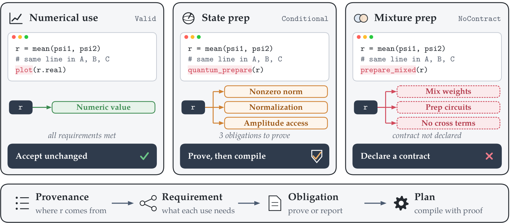
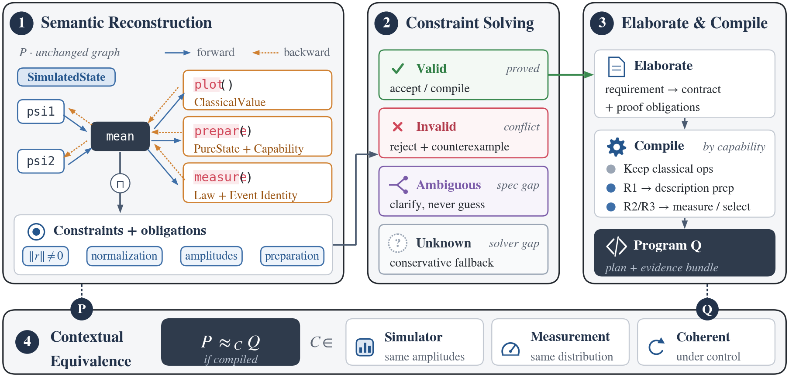
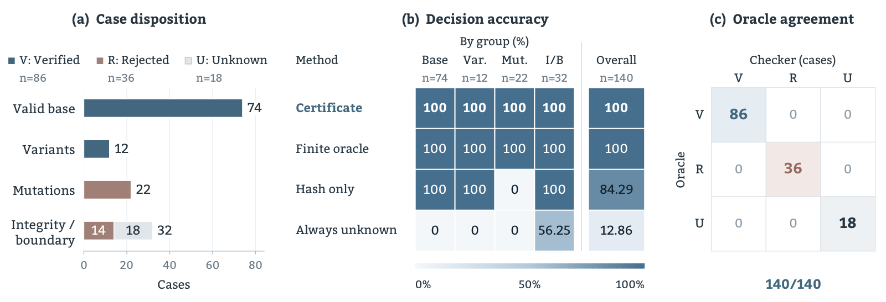
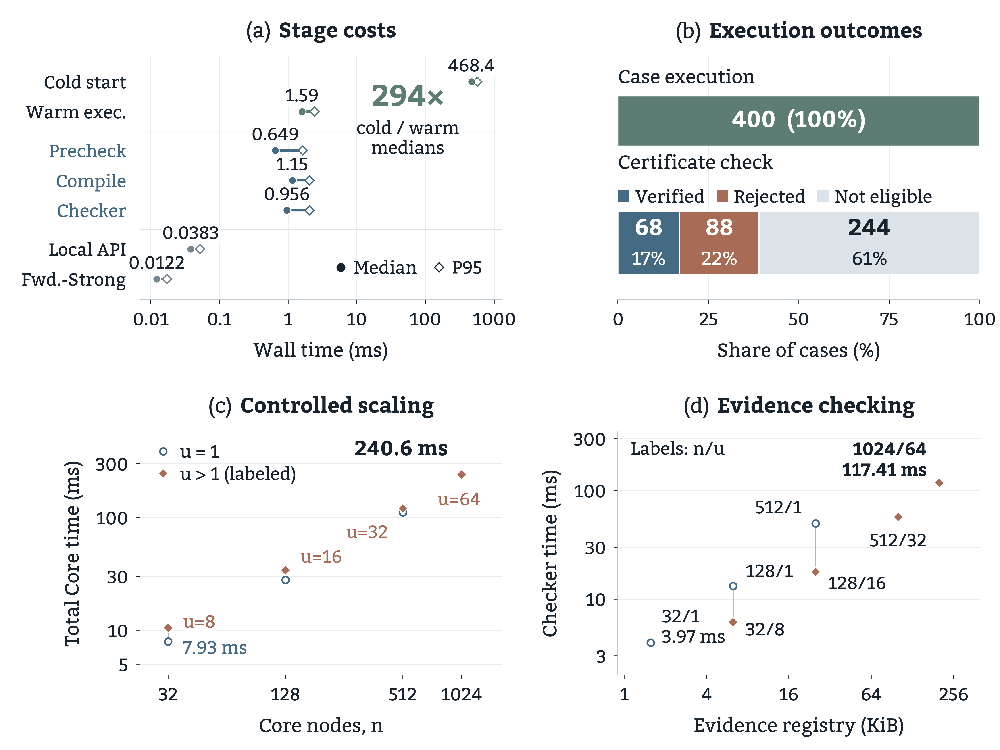

<h1 align="center">QTC</h1>

<div align="center">

### **Make quantum–classical tensor semantics explicit, checkable, and executable.**

QTC turns a tensor dataflow graph into a **contract-resolved plan** with explicit
domain assumptions, backend-aware actions, and independently checkable evidence.

<p>
  
  
  
  
</p>

<p>
  <a href="#why-qtc">Why QTC</a> ·
  <a href="#how-it-works">How it works</a> ·
  <a href="#qtc-results">Results</a> ·
  <a href="#quick-start">Quick start</a> ·
  <a href="#repository-map">Repository</a>
</p>

</div>

> **A quantum tensor is not just a tensor.** Its meaning depends on the consumer:
> a loss may keep a state symbolic, a Born observable may require amplitudes to be
> squared, a selected event may require an ordered basis map, and state preparation
> may require a proof that normalization is defined. QTC makes those distinctions
> visible before execution.

QTC is a compact research prototype for **contract-driven quantum–classical tensor
compilation**. It reconstructs source semantics into a normalized intermediate
representation, solves each consumer contract, emits an executable plan, and binds
the plan to a certificate that a separate checker can validate. The core is usable
without PyTorch or PennyLane; framework adapters are optional front ends.

## Why QTC

Most tensor pipelines treat a value as if its type and its meaning were the same
thing. Quantum–classical programs break that assumption. The same object can be a
ket description, a probability description, a selected submass, a symbolic value,
or a classical array depending on how it is consumed. A permissive conversion can
therefore produce a plausible-looking result while silently changing the program's
semantics.

QTC turns this ambiguity into a compilation boundary with three explicit guarantees:

<table>
<tr>
<td width="33%" valign="top"><strong>1 · Semantic reconstruction</strong><br><br>
Source operations are normalized into a small CoreGraph with stable digests, value
provenance, wire order, domains, and consumer uses.</td>
<td width="33%" valign="top"><strong>2 · Contract solving</strong><br><br>
Every consumer declares what it needs. Rules distinguish exact preservation,
Born/expectation/sample semantics, selected-event gathering, and strict preparation.</td>
<td width="33%" valign="top"><strong>3 · Certificate-backed compilation</strong><br><br>
The emitted plan records assumptions and evidence. A separate checker verifies the
graph digest, plan digest, claims, evidence kinds, execution identities, and basis semantics.</td>
</tr>
</table>

<p align="center">
  
</p>

<p align="center"><em>Motivation: QTC resolves meaning at the consumer boundary instead of forcing one global tensor interpretation.</em></p>

### One value, three legal meanings

Consider a value that looks like a vector:

```python
r = mean(psi_1, psi_2)
```

QTC does not immediately collapse `r` into a single representation. It asks what
the next consumer means:

| Consumer | Required semantics | QTC decision |
| --- | --- | --- |
| Classical loss | Preserve the state-level expression | `KeepOriginal` |
| Computational-basis observable | Apply Born semantics with a declared wire order | `AnalyticMeasure` |
| Selected event | Gather the requested basis event with its mass kind | `GatherEvents` |
| Pure-state preparation | Prove a non-zero norm and emit a preparation action | `PrepareFromDescription` or `Blocked` |

The result is a plan that says **what may happen, why it is valid, and what remains
unproved**. Unknown and blocked cases are first-class outcomes, rather than silent
fallbacks.

## How it works

<p align="center">
  
</p>

<p align="center"><em>QTC pipeline: source semantics → CoreGraph → contract analysis → backend-aware plan → certificate check.</em></p>

The implementation is intentionally layered:

1. **Reconstruct.** A source adapter or fixture produces a normalized `CoreGraph`.
2. **Abstract.** The analyzer tracks representation kind, shape, wire order,
   normalization facts, provenance, and domain conditions.
3. **Resolve.** Consumer contracts select the narrowest sound rule, such as
   `R2-Born`, `R3-Select`, or `R1-StrictAfterNormalization`.
4. **Compile.** A backend profile turns rules into explicit actions and diagnostics.
5. **Check.** `CertificateBundle` and `check_bundle` validate that the emitted plan
   still matches the graph, evidence, and semantic boundary it claims to represent.

This separation is the point: analysis may discover a fact, compilation may use it,
and checking may independently reject a mutated or under-specified plan.

## What the prototype already exposes

<table>
<tr>
<td width="25%" align="center"><strong>Contract-indexed IR</strong><br><sub>Stable graph and plan digests</sub></td>
<td width="25%" align="center"><strong>Explicit domains</strong><br><sub>Conditional facts stay visible</sub></td>
<td width="25%" align="center"><strong>Backend profiles</strong><br><sub>Capabilities shape the plan</sub></td>
<td width="25%" align="center"><strong>Independent checking</strong><br><sub>Evidence is verified separately</sub></td>
</tr>
</table>

The included G0 fixture demonstrates both sides of the boundary:

- With a proven non-zero normalization domain, QTC emits four actions: keep the
  original loss, apply analytic Born measurement, gather a selected event, and
  prepare the state from its description.
- Without that proof, the preparation use is **Blocked** with
  `NonZeroNormalizationObligation`; the other valid uses remain available.

That behavior is small enough to inspect in a terminal and rich enough to exercise
the same semantic distinctions used throughout the QTC experiments.

## QTC results

<p align="center">

</p>

<p align="center"><em>QTC certificate checking on the controlled semantic corpus.</em></p>

The figure evaluates QTC on 140 cases spanning valid plans, valid variants,
semantic mutations, and integrity boundaries. The checker reaches 100% decision
accuracy in every case group and agrees with the independent oracle on all 140
cases. The confusion matrix shows that QTC preserves the three-way distinction
between verified, rejected, and unresolved plans instead of collapsing them into
a single pass/fail result.

<p align="center">

</p>

<p align="center"><em>QTC practicality: stage cost, execution coverage, controlled scaling, and evidence-checking cost.</em></p>

The practicality figure shows a 1.59 ms median for warm execution. The QTC
precheck, compilation, and certificate-checking stages take 0.649, 1.154, and
0.956 ms at the median, while the controlled execution panel completes all
400 cases. The scaling panels show how Core and checker cost changes as the
number of nodes, uses, and evidence records grows.

## Quick start

The core package has no mandatory runtime dependency. Run the fixture from the
directory containing the `QTC/` package:

```bash
# from the parent directory of QTC/
python3 -m QTC
```

The emitted JSON contains a graph digest and an `Emit` plan with actions such as:

```text
KeepOriginal        # preserve the state-level loss
AnalyticMeasure     # apply Born semantics
GatherEvents        # select an explicitly indexed event
PrepareFromDescription
```

To make the normalization obligation conditional:

```bash
python3 -m QTC --zero-domain
```

The plan becomes `Blocked` for the preparation use and reports
`u_prepare: NonZeroNormalizationObligation`. This is deliberate: QTC refuses to
turn an unproved mathematical precondition into a hidden runtime assumption.

For development, use Python 3.10 or newer. The dependency-free core can be tested
with the standard library; the full repository test suite additionally uses
`pytest` for the normalization soundness module:

```bash
python3 -m pip install pytest
python3 -m unittest discover -s tests -v
```

## Why this is difficult to replace with a conventional tensor pass

QTC is not a renamed dtype conversion or a larger router. Its unit of reasoning is
the **consumer contract**. A conventional pass can copy a tensor, but it does not
automatically know whether that copy is an amplitude vector, a probability vector,
a selected submass, or a value whose normalization has only been assumed. QTC keeps
these distinctions in the IR, carries them through compilation, and exposes them
again in a certificate.

Three design choices make that boundary concrete:

- **Consumer-indexed semantics:** the same producer may legally receive different
  actions at different uses.
- **Proof obligations are data:** domains, basis maps, execution identities, and
  evidence references are serialized instead of living only in analyzer control flow.
- **Failure is structured:** `Emit`, `Blocked`, `Unknown`, and `Rejected` communicate
  different reasons and can be audited downstream.

## Repository map

| Path | Role |
| --- | --- |
| `ir.py` | CoreGraph, nodes, uses, source summaries, and stable graph structure |
| `domains.py` | Abstract representation states and domain facts |
| `contracts.py` | Consumer kinds, proof/spec statuses, and plan statuses |
| `analysis.py` | Contract-driven abstract analysis |
| `compiler.py` | Rule elaboration, backend profiles, plans, and diagnostics |
| `certificate.py` | Certificate bundle schema and independent checking |
| `evidence_schemas.py` | Evidence records referenced by certificates |
| `source_to_core.py` | Source-to-CoreGraph reconstruction path |
| `frontend_fx.py` | Optional FX-oriented front end |
| `backend_pennylane.py` | Optional PennyLane integration boundary |
| `g0.py` | Dependency-free end-to-end fixture |
| `assets/` | Motivation, overview, and evaluation figures used by this page |

## Project scope

QTC focuses on making quantum–classical tensor boundaries explicit and auditable.
This repository contains the semantic core, optional framework adapters, the
contract-driven compiler, the certificate checker, and the experiment assets used
to evaluate the system.

<div align="center">

**From “this tensor looks compatible” to “this plan is justified.”**

</div>
